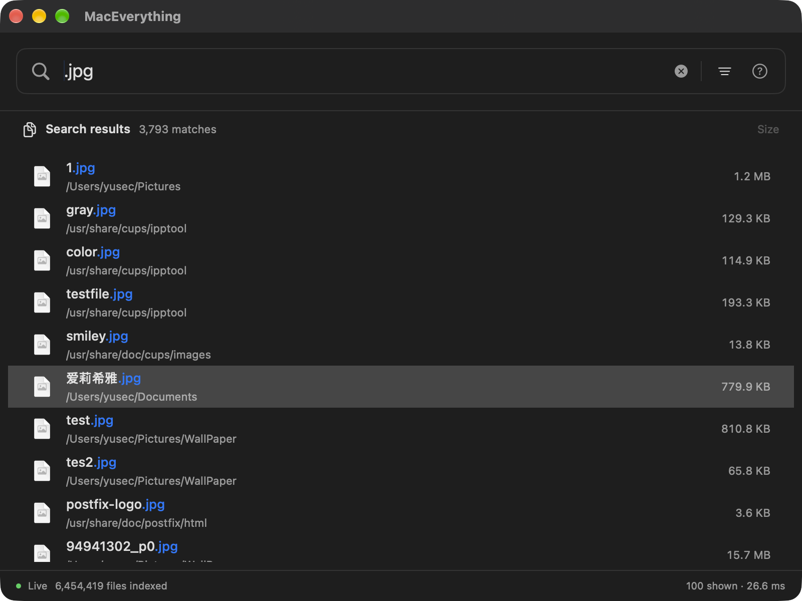

<p align="center">
  
</p>

<h1 align="center">MacEverything</h1>

<p align="center">
  <b>Instant file search for macOS</b> — find any file among millions in milliseconds.<br/>
  Inspired by <a href="https://www.voidtools.com/">Everything</a> on Windows. Built with C++20 and SwiftUI.
</p>

<p align="center">
  <a href="README.md">中文</a> | <b>English</b>
</p>

<p align="center">
  <a href="#installation"></a>
  <a href="LICENSE"></a>
  <a href="#testing"></a>
  <a href="#ai-tool-integration-mcp"></a>
</p>

---

<p align="center">
  
</p>

## Latest Updates · 2026-11-04

Current version: **1.4.0 (Build 4)**. Created by **YuSec**.

- **Smaller resident index**: shared directory/name storage, delta-compressed postings, compact path lookup and narrow metadata columns. A fixed snapshot with 6.38 million live records reached about **573 MiB** of ready physical footprint.
- **Query and mutation improvements**: specialized substring loops, per-thread Top-K, directory candidates and batched posting removal. Deleting 41,562 records on the fixed snapshot dropped from about **1.4 s to 0.25 s**.
- **Menu bar search and paged results**: all searching happens in the menu bar panel (no main window, no Dock icon); load 100 results initially, then fetch more while scrolling.
- **New icon, logo and About window**: open **About MacEverything** from the app menu or the menu bar icon's context menu for the author, version, GitHub link and version notes.
- **Hotkey conflict checks and floating panel**: the shortcut editor flags conflicts with macOS, MacEverything's own menus and common app shortcuts; when the menu bar icon is hidden by the notch or a menu bar manager, the hotkey opens the same search view in a floating panel.
- **Reliability fixes**: rescanning the root directory replaces every record instead of producing duplicate results; full index rewrites are rate-limited by WAL growth to reduce write amplification.
- **Automated releases**: pushing a `v*` tag builds Apple Silicon (arm64) and Intel (x86_64) DMGs in CI and publishes them to Releases with SHA256 checksums.

Figures come from existing local audits and depend on hardware and workload. See the [memory changelog](docs/changelog/146-resident-memory-optimization.md), [algorithm changelog](docs/changelog/147-query-and-prefix-removal.md) and [full history](docs/changelog/README.md) (Chinese).

## Feature Highlights

### Blazing Fast Search

Name trigrams and extension indexes narrow the candidates, while the parallel query engine evaluates complex conditions. On a fixed snapshot with 6.38 million live records, warm samples measured about **0.93 ms** for `*.swift` and **6.13 ms** for `readme`; broad directory queries can take tens of milliseconds.

These are local core-engine timings, excluding GUI debounce, bridging and rendering. Dataset, query and result limits affect latency. See the developer section and the [measurement report](docs/audits/2026-10-22/path-table-dir-runs/report.md).

### Always at Your Fingertips

Press **`Option+Space`** to open the menu bar search panel by default. Configure the shortcut in Shortcut Settings; pressing it again closes the panel and returns to the previous app. Left-click the menu bar icon to search, or right-click it (or use the gear in the panel) for Rebuild Index, shortcut and content settings, MCP, Launch at Login, About and Quit. The panel focuses the input automatically; **Escape** dismisses it. Shortcuts are checked for conflicts when you set them, and if the menu bar icon is hidden by the notch or a menu bar manager, the hotkey opens search in a floating panel. The app lives in the menu bar with no Dock icon and supports launch at login.

### Smart Input Experience

- **Ghost text autocomplete** — semi-transparent suggestions appear as you type, drawn from search history (sorted by frequency) or system keywords (e.g., typing `ex` suggests `ext:`). Press **Tab** to accept
- **Search bar syntax highlighting** — real-time color coding: filter names in purple, arguments in blue, quoted strings in orange, operators in red
- **Search option badges** — colorful badges next to the search bar for one-click toggling of Regex / Case Sensitive / Whole Word / Match Filename

### Everything-Style Query Syntax

Full AST parser supporting 15+ filters, boolean operators, glob wildcards, and regular expressions. Built-in syntax help window (**Cmd+?**).

| Query | Description |
|-------|-------------|
| `readme` | Files containing "readme" in the name |
| `*.swift` | All Swift source files |
| `ext:py size:>1mb` | Python files larger than 1MB |
| `dm:today` | Files modified today |
| `config path:/usr` | Files containing "config" under `/usr` |
| `"exact phrase"` | Exact phrase matching |
| `foo OR bar` | Boolean OR operation |
| `case:Makefile` | Case-sensitive search |
| `regex:^test_.*\.py$` | Regular expression search |
| `type:folder node_modules` | Search directories only |
| `~/Documents/*.pdf` | Tilde expansion + glob |
| `infile:TODO ext:cpp` | Search "TODO" inside C++ files |

<details>
<summary><b>Full filter list</b></summary>

| Filter | Description | Example |
|--------|-------------|---------|
| `ext:` | File extension | `ext:swift,h` |
| `size:` | File size | `size:>1mb`, `size:100kb-5mb` |
| `type:` | File/folder | `type:folder` |
| `path:` | Path contains | `path:Downloads` |
| `nopath:` | Path excludes | `nopath:node_modules` |
| `parent:` | Direct parent directory | `parent:src` |
| `depth:` | Directory depth | `depth:<3` |
| `dm:` | Date modified | `dm:today`, `dm:>2024-01-01` |
| `dc:` | Date created | `dc:thisweek` |
| `da:` | Date accessed | `da:last7days` |
| `len:` | Filename length | `len:>50` |
| `case:` | Case-sensitive | `case:README` |
| `regex:` | Regular expression | `regex:^test_` |
| `ww:` | Whole word match | `ww:test` |
| `wfn:` | Whole filename match | `wfn:Makefile` |
| `content:` / `infile:` | Content search | `infile:TODO` |
| `audio:` `video:` `pic:` `doc:` `zip:` | File type macros | `audio:` = all audio files |

</details>

### Full-Text Content Search

Type `infile:keyword` to search file contents — results include highlighted context snippets around the keyword. Powered by a Trigram index for speed, only re-indexing changed files. Configure indexed file types and max file size in Content Settings.

### Real-Time Sync, Always Up to Date

- **File monitoring** — FSEvents-based real-time file system listener; new, renamed, or deleted files appear in search results immediately
- **Two-phase instant startup** — loads the v6 cache to make search available, then builds acceleration indexes and catches up with changes in the background; queries can fall back to scanning before indexes are ready
- **Focus-aware power saving** — pauses refresh when the app is in the background, batch-catches up on refocus. Near-zero background CPU usage

### Interaction Details

- **Smart highlighting** — matches highlighted in search results, AST-aware: correctly handles glob wildcards, regex, case sensitivity, NOT exclusions, and other complex patterns
- **Drag & drop** — drag files directly from search results to Finder, VS Code, Xcode, or any application
- **Context menu** — Open / Reveal in Finder / Copy Path
- **Cmd+Click** — quickly locate files in Finder
- **Recent files** — automatically shows recently modified files when the search bar is empty
- **Quick Look** — press **Space** while the result list has focus to preview a file, then **Escape** to close the preview
- **About** — view YuSec, version 1.4.0 (Build 4), and the GitHub link; [light](assets/branding/previews/about-light.png) / [dark](assets/branding/previews/about-dark.png) previews

### AI Tool Integration (MCP)

Built-in [Model Context Protocol](https://modelcontextprotocol.io/) server — lets AI coding tools instantly search your file system. Enable with one click from the menu bar. Supports **Claude Code**, **Cursor**, and **Claude Desktop**.

```
Claude Code / Cursor / Claude Desktop
       │
       ▼  (stdio JSON-RPC 2.0)
  MacEverythingMCP
       │
       ▼  (HTTP localhost:19860)
  MacEverything.app
```

| Tool | Description |
|------|-------------|
| `search_files` | Filename search (Trigram-accelerated) |
| `search_content` | Full-text content search |
| `recent_files` | Recently modified files |
| `index_status` | Index statistics & health |

### HTTP API

Local REST API on `localhost:19860` for scripting and automation:

```bash
curl "http://localhost:19860/api/search?q=readme&limit=10"       # Search files
curl "http://localhost:19860/api/search/content?q=TODO"           # Content search
curl "http://localhost:19860/api/recent?limit=20"                 # Recent files
curl "http://localhost:19860/api/status"                          # Index status
```

### Installation

#### Download DMG (Recommended)

1. Download the DMG for your Mac from [Releases](https://github.com/YuSec2021/mac-everything/releases): `MacEverything-<version>-arm64.dmg` for Apple Silicon or `MacEverything-<version>-x86_64.dmg` for Intel (verify with `SHA256SUMS.txt`)
2. Drag `MacEverything.app` to Applications
3. Launch and grant **Full Disk Access** when prompted
4. Allow the initial index to build; time depends on the disk, file count and access permissions
5. Press `Option+Space` to start searching

#### Build from Source

**Requirements:** macOS 14+, Xcode 15+

```bash
brew install re2 abseil
git clone https://github.com/YuSec2021/mac-everything.git
cd mac-everything

xcodebuild -project MacEverything.xcodeproj -scheme MacEverything \
  -configuration Release build SYMROOT=build

# Install and launch
ditto build/Release/MacEverything.app /Applications/MacEverything.app
open /Applications/MacEverything.app

# Optional: package a DMG (statically links re2/abseil; writes dist/MacEverything-<version>-<arch>.dmg)
scripts/build-dmg.sh arm64 1.4.0
```

#### CLI Daemon

Headless mode for servers or automation environments:

```bash
make daemon
./maceverything-daemon --port 19860 --root /
```

---

<h2 align="center">For Developers: Technical Deep Dive</h2>

<p align="center">
  The following content is for developers interested in implementation details.
</p>

### Architecture Overview

```
┌─────────────────────────────────────┐
│       SwiftUI App Layer             │  UI · ViewModel · MVVM
├─────────────────────────────────────┤
│    Objective-C++ Bridge Layer       │  Zero-overhead interop
├─────────────────────────────────────┤
│       C++20 Core Engine             │  Scan · Index · Search · Persist
└─────────────────────────────────────┘
```

The same C++20 core engine powers three deployment modes:

| Mode | Description |
|------|-------------|
| **GUI App** | SwiftUI menu-bar app, `Option+Space` global hotkey |
| **CLI Daemon** | Headless `maceverything-daemon` — same engine, no UI |
| **MCP Server** | `MacEverythingMCP` — stdio JSON-RPC proxy for AI tools |

### Core Engine

| Component | Key Design |
|-----------|-----------|
| **DirectoryScanner** | Multi-threaded work-stealing + `getattrlistbulk` single-syscall bulk attribute reads, 4–32 threads adaptive |
| **SearchEngine** | Name trigram + extension indexes; directory candidates, parallel scans and per-thread Top-K, with stable score/path-length/record-ID ordering |
| **ContentIndex** | Trigram full-text inverted index, FNV-1a hash incremental updates, only re-indexes changed files |
| **SIMDSearch** | ARM NEON 128-bit first-last byte vectorized matching + 2x loop unrolling |
| **IndexPersistence / FlatIndexWriter** | v6 Flat SoA + WAL + streaming CRC + atomic rename; shared read views for saving, with mutations queued during serialization |
| **FileSystemWatcher** | FSEvents + eventId incremental replay + log truncation detection with automatic subtree rescan |
| **DirectoryPool / FoldedNamePool** | Parent-linked directory components; original/lowercase bytes shared where equal, paths reconstructed on demand |
| **PathRecordTable / DirRecordMap** | 4-byte record slots for path lookup; CSR record runs and append tails |
| **PackedPostingList / NarrowColumn** | Varint delta postings with sparse checkpoints; narrow size/time columns with exact overflow storage |
| **QueryParser** | Full AST pipeline: Tokenizer → FilterParser → Parser → QueryAST, 30+ filter keywords |

### Benchmarks

Measurements from **2026-10-22** use a fixed v6 snapshot: 6,460,706 record slots, **6,381,948 live records** and 707,177 parent directories. Queries run in a separate Release/O2 core process, with one warmup and the median of five runs, capped at 10,000 results. GUI overhead is excluded.

#### Query Latency

| Query | Median | Execution strategy |
|-------|-------:|--------------------|
| `*.swift` | 0.93 ms | Name trigram |
| `readme` | 6.13 ms | Name trigram |
| `size:>1mb` | 2.12 ms | Parallel SoA filtering |
| `type:folder` | 2.09 ms | Parallel SoA filtering |
| `path:MacEverything ext:swift` | 0.05 ms | Extension index |
| `MacEverything/a` | 34.62 ms | Directory scan and record expansion |
| `site-packages/a` | 49.96 ms | Directory scan and record expansion |

Sources: [path-table report](docs/audits/2026-10-22/path-table-dir-runs/report.md) and [raw query output](docs/audits/2026-10-22/path-table-dir-runs/after.txt). These warm samples do not represent every query or end-to-end latency.

#### Memory and Incremental Updates

| Optimization round | Before | After |
|--------------------|-------:|------:|
| Narrow columns, 32-bit hashes and allocator setting: ready footprint | 1266.88 MiB | 708.25 MiB |
| Path table, directory runs and removal of inode/devId columns: ready footprint | 702.3 MiB | 573.0 MiB |
| Top-K: sampled extra footprint for `size:>=0` | 179.24 MiB | 2.36 MiB |
| Batched index maintenance: deleting 41,562 records | 1396.9 / 1430.1 ms | 245.7 / 252.8 ms |

Rows come from separate rounds and cannot be combined into one end-to-end measurement. Memory figures are physical footprint; query peaks are sampled values, distinct from RSS or structure capacity. Compression adds decoding and path reconstruction costs, so some queries trade speed for space.

The desktop process in the final memory round had about 6.42 million live records: `footprint` measured **600 MB** after Phase 2 and **612 MB** after about 3.5 minutes. This short observation does not establish a sub-1-GiB bound for long runs, saving, compaction or enabled content indexing.

See the [memory changelog](docs/changelog/146-resident-memory-optimization.md) and [algorithm changelog](docs/changelog/147-query-and-prefix-removal.md) for measurement conditions, compatibility and test scope. Older results remain in the [query benchmark archive](docs/benchmark/README.md) and [SIMD string benchmark](docs/string_search_benchmark_report.md); they are historical measurements rather than current universal performance claims.

### Key Technologies

| Technology | Current implementation |
|------------|------------------------|
| `getattrlistbulk` | Bulk file attributes per syscall, with multi-threaded scanning |
| Name trigram / extension indexes | Narrow candidates; the resident path trigram index has been removed |
| Specialized scans and Top-K | Dedicated substring loops; per-thread top K merged with stable ordering; unlimited queries still retain all matches |
| Directory candidates | Match components in the shared directory tree, then expand records; broad candidates fall back to a full scan |
| SoA / ARM NEON / GCD | Columnar metadata, vectorized string matching and multi-core scanning |
| Compressed storage | Shared original/lowercase names and directories, delta postings, narrow columns and overflow maps |
| Batched prefix removal | Match directories first; group posting removals when at least 64 records match to reduce repeated data movement |
| Session cancellation | Successive GUI queries cancel within their session; independent HTTP requests remain isolated |
| RE2 / FilteredRE2 | Per-thread regex caches with safe regex candidate pre-filtering |
| v6 + WAL | Flat SoA cache, streaming CRC and atomic replacement; full saves still amplify I/O and briefly defer mutations |
| Paged bridge | Menu bar panel and HTTP API share the engine; ID snapshots produce pages, skip tombstones and require a new query after compaction |

### Testing

Core regression suites, bridge snapshots and UI tests cover major functionality. AddressSanitizer and ThreadSanitizer builds are available:

```bash
make test          # Fast unit tests + bridge lint
make test-slow     # Integration tests (full disk scan, FSEvents, E2E)
make test-all      # All tests
make test-asan     # AddressSanitizer
make test-tsan     # ThreadSanitizer
make test-bridge-snapshot  # Objective-C++ paged snapshots
```

Coverage:

- **Core engine**: scan, query, mutation, compaction, ranking, path search
- **Persistence**: WAL CRC integrity, batch replay, v5 compatibility and v6 save/reload
- **Content index**: trigram, compaction, mod-time tracking, WAL tracking
- **Search/Query**: tokenizer, parser, filters, date filters, structured queries, regex trigram, highlight hints
- **Performance**: SIMD search, 10M-record synthetic benchmarks, trigram competition
- **Integration**: thread safety, E2E, HTTP engine hot-swap, MCP protocol
- **Memory safety**: hash collisions, narrow-column overflow, randomized delta-list mutations, ASan + TSan builds

Historical pass counts and sanitizer findings apply to the specific groups and environments in each report. See the [changelog](docs/changelog/README.md) for validation scope.

### Project Structure

```text
mac-everything/
├── MacEverything/
│   ├── Core/              # C++20 queries, scanning, compressed indexes, v6/WAL, HTTP
│   ├── Bridge/            # Objective-C++ interop and paged result snapshots
│   ├── App/               # SwiftUI menu bar search panel, shortcuts, settings, About
│   ├── CLI/               # Daemon and MCP stdio server
│   └── Assets.xcassets/   # App icon and menu bar template
├── MacEverythingUITests/  # Native UI tests
├── tests/                 # C++ regression and bridge tests
├── assets/branding/       # Logos, SVG sources and icon generation script
└── docs/                  # Changelogs, audits and raw benchmark data
```

## Contributing

Contributions are welcome! Please follow this workflow:

1. Fork the repository
2. Create a feature branch (`feat/...`) or bugfix branch (`fix/...`)
3. Write tests for new functionality
4. Ensure `make test-all` passes
5. Submit a Pull Request

## License

This project is licensed under the MIT License — see the [LICENSE](LICENSE) file for details.

---

<p align="center">
  <b>If MacEverything helps you find files faster, consider giving it a star!</b>
</p>
